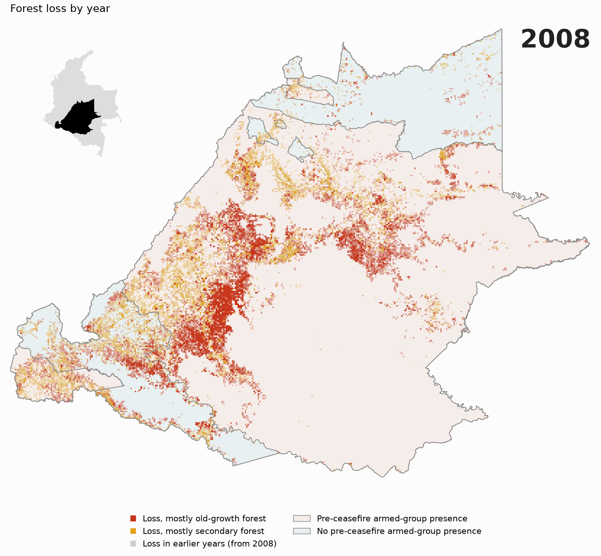
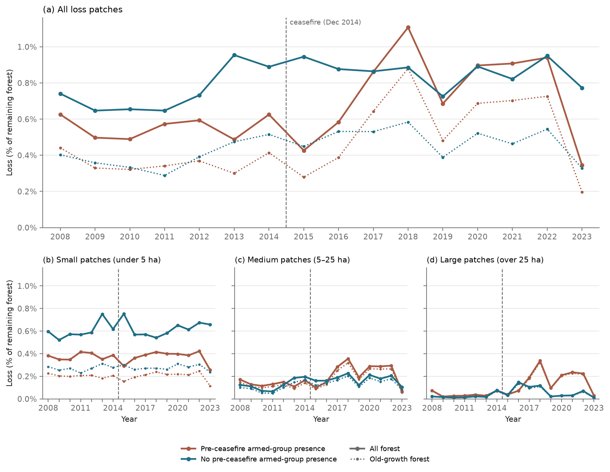

# Piedemonte forest loss

Where forest was cleared in Colombia's Andean–Amazon piedmont after the December 2014 ceasefire, which forest it was, and what that clearing emitted.

> **Work in progress.** Sections are filled in as each part of the analysis is finished.

## Context

Caquetá, Guaviare, Meta and Putumayo, the departments where the Andes meet the Amazon lowlands, form the core of Colombia's Amazon deforestation frontier, often called the deforestation arc (*arco de deforestación*). Prem et al. (2020) showed that after the ceasefire, deforestation rose more in municipios with pre-ceasefire armed-group presence than in other municipios.

This project looks instead at where the post-ceasefire loss happened relative to roads, rivers, protected areas, Indigenous resguardos (collectively titled Indigenous territories) and earlier clearings, and whether it cleared old-growth or secondary forest.

## Questions

1. Did post-ceasefire clearing move away from roads, rivers and existing clearings, or concentrate around them?
2. Did it shift between old-growth and secondary forest?
3. How spatially clustered is it, and how much of the pattern does accessibility explain once that clustering is modeled? Do municipios with pre-ceasefire armed-group presence still stand out?
4. How much CO₂ did it release, and how much of that came from old-growth forest?

## Study area

The four departments (Caquetá, Guaviare, Meta and Putumayo) cover about 257,000 km² and contain 62 municipios, the municipalities that make up the administrative level below the department. The area spans the Andean foothills, Amazon lowland forest and, in northern and eastern Meta, the savannas of the Llanos.

The departments are taken whole, so the boundary follows administrative lines rather than the piedmont itself; savanna is excluded later through a minimum forest share. Municipios on the far side of department borders, such as the piedmont of the Bota Caucana in Cauca, fall outside the study area.

## Data

Forest loss comes from MapBiomas Colombia, whose annual land-cover maps at 30 m run from 1985 to 2024. Pre-ceasefire armed-group presence by municipio comes from the replication data of Prem et al. (2020), with one addition described below. Five landscape layers place each loss patch: roads, rivers, protected areas, Indigenous resguardos and slope. Global Forest Change serves as a comparison for the loss data. Table 1 lists every source.

**Table 1.** Datasets used.

| Dataset | Used for | Version / access |
|---|---|---|
| MapBiomas Colombia | Annual land cover; forest loss and forest history | Collection 3 (1985–2024) |
| Global Forest Change (Hansen et al., 2013) | Comparison with MapBiomas loss | v1.13 |
| ESA CCI Biomass | Above-ground biomass for emission factors | v7.0 |
| GRIP4 (Meijer et al., 2018) | Roads (pre-ceasefire network) | Region 2; in the study area, IGAC mapping dated 2012 |
| IGAC drainage | Wide rivers (mapped as polygons) | 1:100,000, via IDEAM's map service, accessed 2026-10-23 (study departments) and 2026-11-02 (200 km buffer ring) |
| HydroRIVERS (Lehner and Grill, 2013) | Comparison in choosing the river layer | v1.0 |
| RUNAP | Protected areas | accessed 2026-06-28 |
| ANT resguardos (Agencia Nacional de Tierras, 2026) | Indigenous resguardos | data updated 2026-06-25, accessed 2026-11-02 |
| SRTM (Farr et al., 2007) | Slope | SRTMGL1 v3 (NASA JPL, 2013; 1 arc-second, 2000), via Earth Engine |
| HDX COD-AB (DANE) | Municipio boundaries | 2020 |
| Prem et al. (2020) replication data | Pre-ceasefire armed-group presence (`FARC1`, `FARC2`) | authors' replication files (dated 2020-03-04), accessed 2026-06-28 |

### Pre-ceasefire armed-group presence

Prem et al. (2020) code a municipio as having armed-group presence if at least one violent event was attributed to the group in 2011–2014 (`FARC1`). This project also counts municipios without such an event that share at least 80% of their border with municipios that had one, and where the Centro Nacional de Memoria Histórica recorded at least one selective killing attributed to the group in the same years (`FARC2`). A municipio almost enclosed by violent presence, with killings recorded by a second source, is unlikely to be outside the group's reach. This adds four municipios, giving 30 of 62 with presence. Both measures record violence, not territorial control ([D7](docs/decisions/design.md)).


**Figure 1.** Municipios by pre-ceasefire armed-group presence.

Forest loss before and after the ceasefire is compared between these two groups: the 30 municipios with pre-ceasefire armed-group presence, called Presence Municipios from here on, and the 32 without, called No-Presence Municipios. The Presence Municipios are much larger and cover three quarters of the study area.

### Landscape layers

Each loss patch is measured against the layers in Figure 2: its distance to the closest road, wide river, protected area and Indigenous resguardo, whether it lies inside or touches a protected area or resguardo, and its mean slope. One more attribute, the distance to the closest loss patch of the three previous years, comes from the loss data itself. Wide rivers are those IGAC maps as polygons, with both banks drawn, at 1:100,000. Narrower streams, mapped as single lines, are left out: nine in ten forest points lie within 0.75 km of one, so the distance to them barely differs from place to place ([A9](docs/decisions/data.md)).


**Figure 2.** Landscape layers over the two municipio groups. Slope is averaged to 250 m for display.

The 30 Presence Municipios cover 198,000 of the 257,000 km² study area. Taken as a whole, their territory has fewer roads (141 km per 1,000 km², against 351 in the No-Presence Municipios), less land near wide rivers (27% within 5 km, against 47%) and more of it protected (33%, against 12%). Resguardos cover about a fifth of both groups.

## Methods

The analysis has three parts. Years up to 2014 are pre-ceasefire, and 2015 is the first post-ceasefire year ([D3](docs/decisions/design.md)).

**Loss patches.** Annual MapBiomas land cover gives the forest lost each year from 2008 to 2023, and whether it was old-growth or secondary forest. Old-growth forest here is forest with no recorded clearing since 1985, when the record starts (never two consecutive years of agriculture or other human use): primary forest, plus regrowth that was already forest in 1985. Secondary forest is regrowth on land cleared since then ([D12](docs/decisions/design.md)). A pixel counts as lost in year t if it was forest in the two previous years and an agricultural or other human-made class in t and t+1, which filters out single-year classification errors ([D9](docs/decisions/design.md)). Loss pixels that share an edge form a patch; single-pixel patches are left out of the analysis ([D13](docs/decisions/design.md)). Each patch then gets the attributes described under Landscape layers ([D14](docs/decisions/design.md), [A11](docs/decisions/data.md)). The annual loss rate is the percentage of remaining forest lost in a year, where remaining forest is the area that was forest in the two previous years, the only forest the loss rule can flag ([D15](docs/decisions/design.md)). These measures are compared before (2008–2014) and after (2015–2023) the ceasefire, between Presence and No-Presence Municipios.

**Spatial model.** Loss rates are summarized on a hexagon grid (H3). Clustering is measured with Moran's I and local indicators of spatial association (LISA), and loss rates are modeled with OLS and spatial lag and error models.

**Emissions.** Loss area is multiplied by emission factors derived from ESA CCI above-ground biomass, giving gross CO₂ by year, forest type and armed-group presence.

## Results

This section describes patterns found while exploring the loss data. It reports no statistical tests and makes no causal claims.

### Loss patches derived from MapBiomas



**Figure 3.** Forest loss by year, 2008–2023, in 2 km cells. Each frame shows one year's loss patches; a cell is drawn when at least 1 ha was lost in it, colored by the forest type that lost more area and more opaque the larger the share of the cell lost (full at 5%). Loss recorded in earlier years stays in gray.

Loss runs along a band from the Putumayo foothills through Caquetá into southern Meta and Guaviare, the deforestation arc, while the large forest blocks of the south and east stay almost untouched. From 2017, loss of old-growth forest (no recorded clearing since 1985; see Methods) in that band spreads further than in any earlier year: in 2018, five Presence Municipios (San Vicente del Caguán, Cartagena del Chairá, La Macarena, San José del Guaviare and Calamar) account for almost two thirds of the year's old-growth loss. In 2023 that clearing thins out.

### Forest loss after the ceasefire



**Figure 4.** Annual forest loss as a share of remaining forest: (a) all loss patches; (b)–(d) the same loss by patch size.

After the ceasefire, loss in Presence Municipios rose from below the No-Presence Municipios' rate to level with it, climbing from 2016 to a peak in 2018. Over 2015–2023, Presence Municipios lost on average 0.75% of their remaining forest a year, against 0.56% before the ceasefire, a rise of about a third. No-Presence Municipios lost 0.86%, against 0.75% before, a rise of about a seventh; their rate had already stepped up in 2013, before the ceasefire. This is the direction Prem et al. (2020) found, here as an association.

Panels (b) to (d) split the loss in (a) by patch size and add up to it. Small clearings, under 5 ha, carry most of the loss in both groups before the ceasefire (68% of the loss area in Presence Municipios, 80% in No-Presence Municipios) and change little after it: 0.29–0.42% of remaining forest a year in Presence Municipios and 0.52–0.75% in No-Presence Municipios over 2008–2022. The rise came almost entirely from clearings of 5 ha or more. Clearings over 25 ha, rare in both groups before the ceasefire, rose far more in Presence Municipios.

In both groups the added loss was mostly old-growth forest: over 95% of it in Presence Municipios and over 80% in No-Presence Municipios, while secondary-forest loss barely changed (about 0.2% and 0.37% of remaining forest a year). Old-growth forest made up 65% of the Presence Municipios' loss area before the ceasefire and 74% after, against 52% and 56% in No-Presence Municipios. Later years have a longer land-cover record, so more regrowth is recognized as secondary over time ([D12](docs/decisions/design.md)); this lowers the old-growth share in later years, so it cannot explain the rise.

In 2023, loss visibly fell, especially in Presence Municipios. Official figures also show a sharp fall: deforestation in Colombia's Amazon region dropped 38% from 2022 to 2023, and by 27–57% in each of the four departments (MinAmbiente, 2024); GFC records a 49% fall in Colombia's primary forest loss (WRI, 2024). Reports attribute it partly to government policy and partly to armed groups negotiating with the government, one of which announced penalties on forest clearing. Those groups formed after the 2016 peace agreement, so their territories need not match the presence measured here for 2011–2014.

### Where the loss happened

Patch by patch, distance to roads and rivers, contact with earlier clearings and slope changed little after the ceasefire in either group. What rose was the share of loss inside or touching a protected area in Presence Municipios, and inside or touching a resguardo in No-Presence Municipios. Figure, table and caveats: [Where the loss happened](docs/supplementary/where_loss_happened.md).

### Comparison with Global Forest Change

MapBiomas loss of old-growth forest was also compared with Global Forest Change (GFC; Hansen et al., 2013), the most widely used global product: each records most of the old-growth loss the other finds (70% and 84% on the same pixel, within a year). Secondary-forest loss cannot be compared, because GFC keeps only the first loss after 2000 in each pixel. Method and details: [Comparison with Global Forest Change](docs/supplementary/gfc_comparison.md).

## Limitations

- Results are associations. Unlike Prem et al. (2020), the project does not isolate the effect of the ceasefire, so differences between Presence and No-Presence Municipios may reflect other factors, such as remoteness or land use, that already set the groups apart ([D6](docs/decisions/design.md)).
- Old-growth forest means no recorded clearing since 1985, when the MapBiomas record starts. Regrowth on land cleared before then counts as old-growth, so old-growth loss is overstated and secondary loss understated, more so in earlier years, which have a shorter record ([D12](docs/decisions/design.md)).
- Pre-ceasefire armed-group presence is recorded per municipio, the unit of the Prem et al. (2020) data, so all of a municipio's forest counts as having presence even where the group was not active. Large municipios weigh more in the group rates: Solano alone holds about a quarter of the forest in Presence Municipios ([D7](docs/decisions/design.md)).
- Protected areas, resguardos and roads are fixed in time. Protected areas and resguardos are taken at their current boundaries for every year, since the sources (RUNAP, the national registry of protected areas, and ANT) hold only those. Protected areas grew from 2008 to 2023 (Chiribiquete, the largest, was enlarged in 2013 and 2018), so the share of loss inside them is inflated in earlier years. Roads are the 2012 IGAC network, so roads opened after the ceasefire are missing ([A5](docs/decisions/data.md), [A6](docs/decisions/data.md), [A10](docs/decisions/data.md)).
- 2023, the last loss year, likely combines a real decline with an end-of-series effect. Official figures also fall sharply that year, but less than ours: about 43% across the four departments, against 57% here. 2023 is the last year the loss rule can confirm, from the last map of the collection, and agreement with GFC on old-growth loss falls that year to about its 2013–2015 level ([comparison with GFC](docs/supplementary/gfc_comparison.md)). Without 2023, Presence Municipios lost on average 0.80% of their remaining forest a year after the ceasefire and No-Presence Municipios 0.87%, and every before/after difference in the [patch attributes](docs/supplementary/where_loss_happened.md) keeps its sign ([D8](docs/decisions/design.md)).
- Single-pixel patches (19% of loss pixels, 65% of them secondary forest) are left out, so loss totals and the secondary share are understated ([D13](docs/decisions/design.md)).
- Areas are pixel counts from the maps, not estimates corrected for classification error with a reference sample, so they carry the maps' own errors. Secondary-forest loss is also checked against no other product ([comparison with GFC](docs/supplementary/gfc_comparison.md)).

## How to reproduce

```bash
conda env create -f environment.yml
conda activate piedemonte-forest
cp .env.example .env              # fill in your own values
make db                           # PostGIS (docker compose)
make raw                          # download raw inputs
make study                        # study area and treatment table
make input-maps                   # maps of the municipio groups and the landscape layers
make loss                         # loss rasters (Earth Engine), loss patches, remaining forest
make covariates                   # patch attributes (needs make db)
make loss-figures                 # loss figures and table; the GFC comparison runs on Earth Engine if missing
```

The `Makefile` holds the run order: each target is an output file, rebuilt only when missing or older than its inputs. Scripts live in `scripts/<stage>/` and run from the repository root. The modules they share are in `src/piedemonte_forest/`, installed into the environment by `environment.yml`.

## Use of AI tools statement

This project was developed with Claude (Anthropic) as a coding, writing and research assistant. Claude wrote most of the code, while I wrote several core functions and reviewed the rest; it also ran the Earth Engine jobs, searched and summarized documentation and literature, and drafted most of this text, which I reviewed and rewrote in places. Methodological options came from both of us; I made every final choice, several times against Claude's proposal, and set the project's constraints. Results were checked against independent sources (MapBiomas' own statistics, Global Forest Change and official deforestation figures), and I checked the cited references to confirm they support what is said. Every methodological choice and its reasoning is recorded in [`docs/decisions/`](docs/decisions/). This paragraph was also drafted by Claude, and reviewed and rewritten in places by me.

## References

[dataset] Agencia Nacional de Tierras, 2026. Resguardo Indígena Formalizado. Dirección de Asuntos Étnicos, data updated 25 June 2026. © Agencia Nacional de Tierras - Dirección de Asuntos Étnicos 2022, licensed under CC BY-SA 4.0 (https://creativecommons.org/licenses/by-sa/4.0/); clipped to the study area and self-touching polygons repaired. https://utility.arcgis.com/usrsvcs/servers/8944116ccfd34a7189c4bc44b8e19186/rest/services/DatosAbiertos/Resguardo_Indigena_Formalizado/FeatureServer/0 (accessed 2 November 2026).

Farr, T.G., Rosen, P.A., Caro, E., Crippen, R., Duren, R., Hensley, S., Kobrick, M., Paller, M., Rodriguez, E., Roth, L., Seal, D., Shaffer, S., Shimada, J., Umland, J., Werner, M., Oskin, M., Burbank, D., Alsdorf, D., 2007. The Shuttle Radar Topography Mission. Rev. Geophys. 45, RG2004. https://doi.org/10.1029/2005RG000183

Hansen, M.C., Potapov, P.V., Moore, R., Hancher, M., Turubanova, S.A., Tyukavina, A., Thau, D., Stehman, S.V., Goetz, S.J., Loveland, T.R., Kommareddy, A., Egorov, A., Chini, L., Justice, C.O., Townshend, J.R.G., 2013. High-resolution global maps of 21st-century forest cover change. Science 342, 850–853. https://doi.org/10.1126/science.1244693

Lehner, B., Grill, G., 2013. Global river hydrography and network routing: baseline data and new approaches to study the world's large river systems. Hydrol. Process. 27, 2171–2186. https://doi.org/10.1002/hyp.9740

Meijer, J.R., Huijbregts, M.A.J., Schotten, K.C.G.J., Schipper, A.M., 2018. Global patterns of current and future road infrastructure. Environ. Res. Lett. 13, 064006. https://doi.org/10.1088/1748-9326/aabd42

MinAmbiente (Ministerio de Ambiente y Desarrollo Sostenible), 2024. Reducción histórica de la deforestación en la Amazonía colombiana. Press release, 8 July 2024. https://www.minambiente.gov.co/reduccion-historica-de-la-deforestacion-en-la-amazonia-colombiana/ (accessed 8 November 2026).

[dataset] NASA JPL, 2013. NASA Shuttle Radar Topography Mission Global 1 arc second, version 3. NASA EOSDIS Land Processes DAAC; public domain; accessed through Google Earth Engine (USGS/SRTMGL1_003). https://doi.org/10.5067/MEaSUREs/SRTM/SRTMGL1.003

Prem, M., Saavedra, S., Vargas, J.F., 2020. End-of-conflict deforestation: evidence from Colombia's peace agreement. World Dev. 129, 104852. https://doi.org/10.1016/j.worlddev.2019.104852

WRI (World Resources Institute), 2024. How much forest was lost in 2023? Global Forest Review. https://gfr.wri.org/global-tree-cover-loss-data-2023 (accessed 8 November 2026).

Design decisions are logged in [`docs/decisions/`](docs/decisions/).
