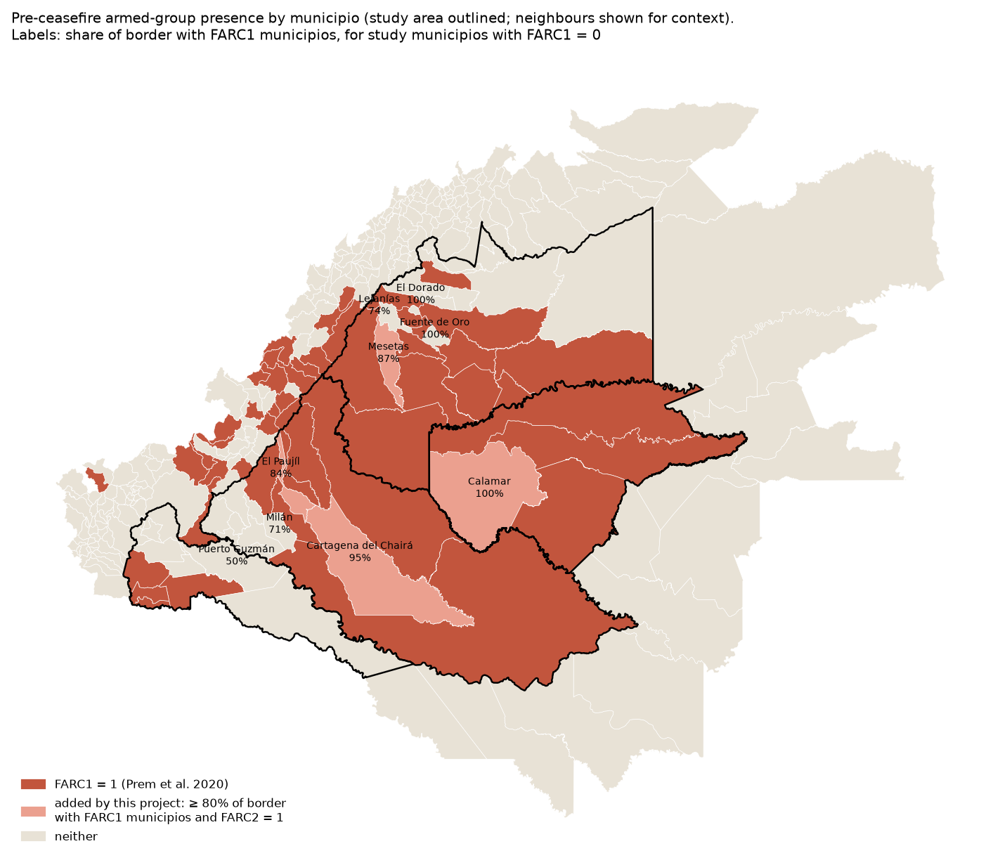
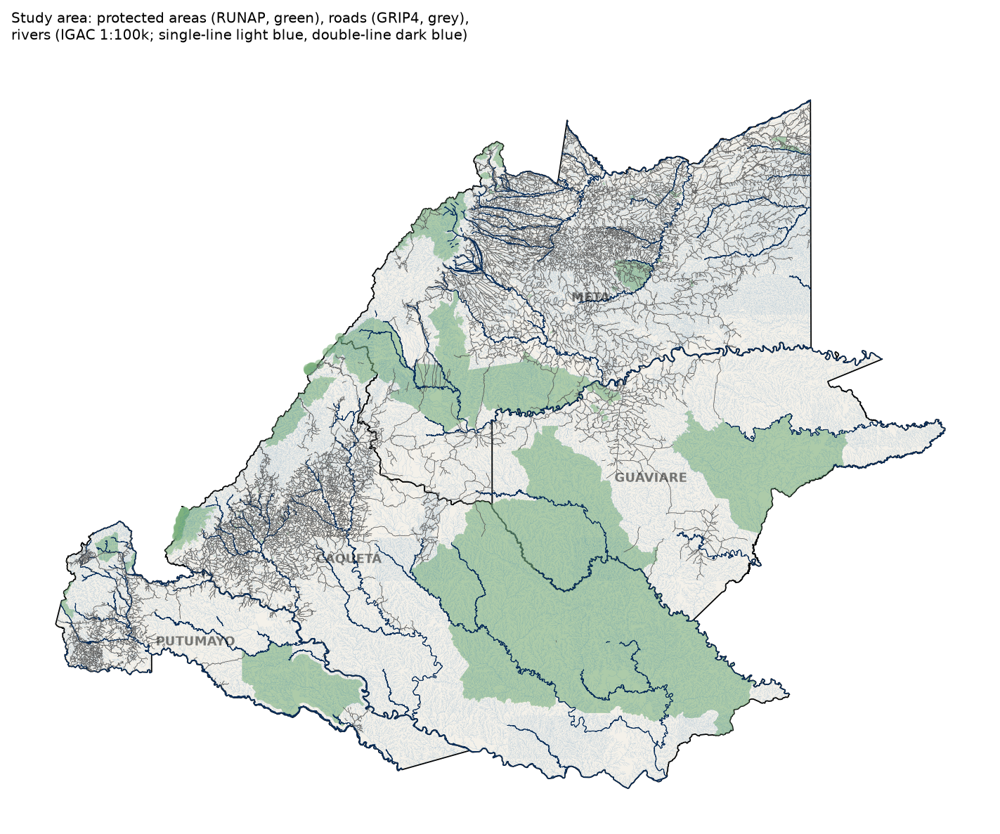

# Piedemonte forest loss

Where forest was cleared in Colombia's Andean–Amazon piedmont after the 2014–2016 ceasefire, which forest it was, and what that clearing emitted.

> **Work in progress.** Sections are filled in as each part of the analysis is finished.

## Context

Caquetá, Guaviare, Meta and Putumayo, the departments where the Andes meet the Amazon lowlands, form the core of Colombia's Amazon deforestation frontier, often called the deforestation arc (*arco de deforestación*). Prem et al. (2020) showed that after the ceasefire, deforestation rose more in municipios with pre-ceasefire armed-group presence than in other municipios. The increase was smaller where state presence and judicial capacity were higher, and larger where land-intensive economic activities were common.

Their study measured how much forest was lost. This project looks at where the post-ceasefire loss happened relative to roads, rivers, protected areas and earlier clearings, and whether it cleared primary or secondary forest.

## Questions

1. Did post-ceasefire clearing move away from roads, rivers and existing clearings, or concentrate around them?
2. Did it shift between primary and secondary forest?
3. How spatially clustered is it, and how much of the pattern does accessibility explain once that clustering is modelled? Do municipios with pre-ceasefire armed-group presence still stand out?
4. How much CO₂ did it release, and how much of that came from primary forest?

The results are associations, not causal estimates.

## Study area

The four departments (Caquetá, Guaviare, Meta and Putumayo) cover about 257,000 km² and contain 62 municipios, the municipalities that make up the administrative level below the department. The area spans the Andean foothills, Amazon lowland forest and, in northern and eastern Meta, the savannas of the Llanos.

The departments are taken whole, so the boundary follows administrative lines rather than the piedmont itself; savanna is excluded later through a minimum forest share. Municipios on the far side of department borders, such as the piedmont of the Bota Caucana in Cauca, fall outside the study area.

### Pre-ceasefire armed-group presence

Prem et al. (2020) code a municipio as having armed-group presence if at least one violent event was attributed to the group in 2011–2014 (`FARC1`). This project adds untreated municipios that share at least 80% of their border with such municipios and had at least one selective killing attributed to the group in the same years, as recorded by the Centro Nacional de Memoria Histórica (`FARC2`). A municipio almost enclosed by violent presence, with killings recorded by a second source, is unlikely to be outside the group's reach. This adds four municipios, giving 30 of 62 with presence. Both measures record violence, not territorial control.



## Data

| Dataset | Used for | Version / access |
|---|---|---|
| MapBiomas Colombia | Annual land cover; forest loss and forest history | Collection 3 (1985–2024) |
| Global Forest Change (Hansen et al., 2013) | Comparison with MapBiomas loss | v1.13 |
| ESA CCI Biomass | Above-ground biomass for emission factors | v7.0 |
| GRIP4 (Meijer et al., 2018) | Roads (pre-ceasefire network) | Region 2; in the study area, IGAC mapping dated 2012 |
| IGAC drainage | Rivers | 1:100,000, via IDEAM's map service, accessed 2026-10-23 |
| HydroRIVERS (Lehner and Grill, 2013) | Comparison with IGAC rivers (quick-look maps only) | v1.0 |
| RUNAP | Protected areas | accessed 2026-06-28 |
| HDX COD-AB (DANE) | Municipio boundaries | 2020 |
| Prem et al. (2020) replication data | Pre-ceasefire armed-group presence (`FARC1`, `FARC2`) | authors' replication files (dated 2020-03-04), accessed 2026-06-28 |

### A first look at the data



Rivers come from IGAC's 1:100,000 drainage rather than HydroRIVERS, whose channels are modelled from elevation data; [El Doncello](figures/inputs/rivers_el_doncello.png), a municipio spanning foothills and lowland, shows the difference.

## Methods

The following is a rough sketch of the three parts of the analysis. Years up to 2014 are pre-ceasefire, and 2015 is the first post-ceasefire year.

1. **Loss patches.** Annual MapBiomas land cover gives the forest pixels lost each year and whether they were primary forest or secondary regrowth. Loss pixels are grouped into patches, and each patch is measured against roads, rivers, protected areas and earlier clearings. Patterns before and after the ceasefire are compared between municipios with and without pre-ceasefire armed-group presence. Hansen loss serves as a cross-check.
2. **Spatial model.** Loss rates are summarised on a hexagon grid (H3). Clustering is measured with Moran's I and local indicators of spatial association (LISA), and loss rates are modelled with OLS and spatial lag and error models.
3. **Emissions.** Loss area is multiplied by emission factors derived from ESA CCI above-ground biomass, giving gross CO₂ by year, forest type and armed-group presence.

## Results

*To be added.*

## Limitations

- Results are associations. Unlike Prem et al. (2020), this project has no identification strategy, so differences between municipios with and without pre-ceasefire armed-group presence may reflect other factors, such as remoteness or land use, that already differed between the two groups.

*More to be added.*

## Reproduce

```bash
conda env create -f environment.yml
conda activate piedemonte-forest
cp .env.example .env              # fill in your own values
make db                           # PostGIS (docker compose)
make raw                          # download raw inputs
make study                        # study area and treatment table
make input-quicklook              # optional: quick-look maps of the inputs (downloads HydroRIVERS, ~95 MB)
```

The `Makefile` holds the run order: each target is an output file, rebuilt only when missing or older than its inputs. Scripts live in `scripts/<stage>/` and run from the repository root.

## References

Hansen, M.C., Potapov, P.V., Moore, R., Hancher, M., Turubanova, S.A., Tyukavina, A., Thau, D., Stehman, S.V., Goetz, S.J., Loveland, T.R., Kommareddy, A., Egorov, A., Chini, L., Justice, C.O., Townshend, J.R.G., 2013. High-resolution global maps of 21st-century forest cover change. Science 342, 850–853. https://doi.org/10.1126/science.1244693

Lehner, B., Grill, G., 2013. Global river hydrography and network routing: baseline data and new approaches to study the world's large river systems. Hydrol. Process. 27, 2171–2186. https://doi.org/10.1002/hyp.9740

Meijer, J.R., Huijbregts, M.A.J., Schotten, K.C.G.J., Schipper, A.M., 2018. Global patterns of current and future road infrastructure. Environ. Res. Lett. 13, 064006. https://doi.org/10.1088/1748-9326/aabd42

Prem, M., Saavedra, S., Vargas, J.F., 2020. End-of-conflict deforestation: evidence from Colombia's peace agreement. World Dev. 129, 104852. https://doi.org/10.1016/j.worlddev.2019.104852

Design decisions are logged in [`docs/decisions/`](docs/decisions/).
