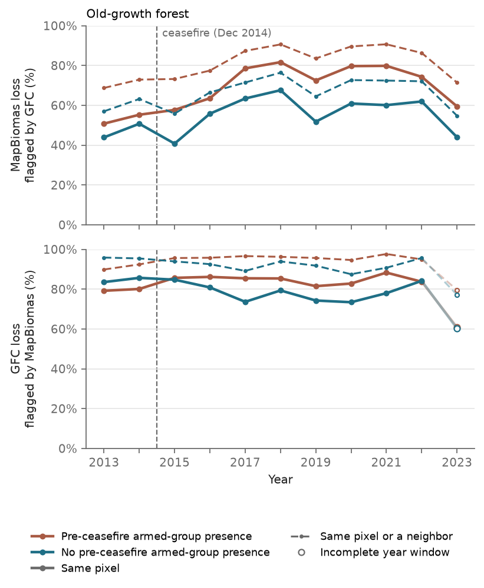

# Comparison with Global Forest Change

Supplementary result to the [README](../../README.md#comparison-with-global-forest-change). Loss, old-growth and secondary forest, and the two municipio groups are defined there.

Global Forest Change (GFC; Hansen et al., 2013) is the usual global reference for forest loss, but it is not the outcome here, for three reasons ([D4](../decisions/design.md), [D5](../decisions/design.md)). It records tree cover loss from any cause, while MapBiomas classifies land use every year, so forest turned into pasture can be told apart from other losses of tree cover. GFC starts in 2000 and keeps only the first loss after that in each pixel, so it can neither split loss into old-growth and secondary forest nor record regrowth that is cleared again after an earlier recorded loss. And its detection method changed in 2011, 2013 and 2015, which would mix with a before/after-2015 comparison.

The comparison therefore covers old-growth forest only, where both products can record the loss: MapBiomas sees no clearing there since 1985, so the loss should be the first GFC records. Secondary-forest loss is not checked against any other product. MapBiomas loss is compared with GFC loss (v1.13) pixel by pixel on the MapBiomas grid, using all loss pixels, single pixels included. A loss pixel counts as matched when the other product records loss in the year before, the same year or the year after, on the same pixel or one of its eight neighbors. The comparison starts in 2013, the first year of Landsat 8 imagery in GFC's reprocessed series (years before 2011 still use GFC's older method); its 2015 change falls inside the comparison.

**Figure 1.** Agreement between MapBiomas and GFC on old-growth loss, by year. Top: share of MapBiomas old-growth loss that GFC also records; bottom: share of GFC loss inside MapBiomas old-growth forest that MapBiomas also records.

Each product records most of the old-growth loss the other finds. Over 2013–2023, GFC records 70% of the MapBiomas old-growth loss area on the same pixel within a year, and 81% on the same pixel or a neighbor. In the other direction, 84% of GFC loss inside MapBiomas old-growth forest is also MapBiomas loss (95% with neighbors, 2013–2022). Agreement rises after 2015 in both groups; GFC's 2015 change in detection and the larger clearings of those years could each explain it, and the comparison cannot separate them. In the bottom panel, 2023 is drawn hollow: matching GFC's 2023 loss needs MapBiomas loss for 2024, which the loss rule can only confirm with a 2025 map, so that point uses 2022 and 2023 alone and is biased low.

Hansen, M.C., Potapov, P.V., Moore, R., Hancher, M., Turubanova, S.A., Tyukavina, A., Thau, D., Stehman, S.V., Goetz, S.J., Loveland, T.R., Kommareddy, A., Egorov, A., Chini, L., Justice, C.O., Townshend, J.R.G., 2013. High-resolution global maps of 21st-century forest cover change. Science 342, 850–853. https://doi.org/10.1126/science.1244693
